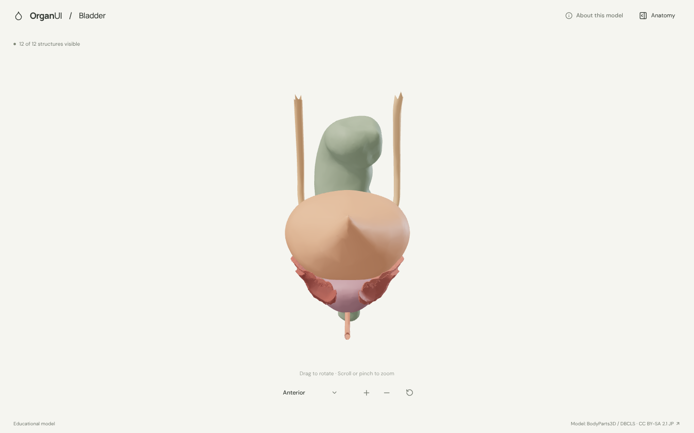
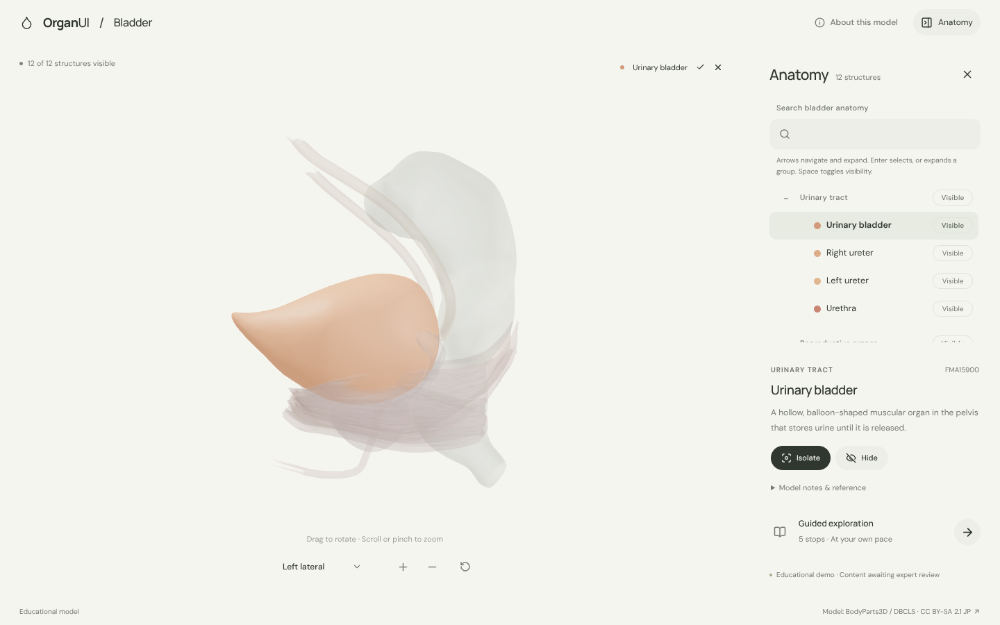
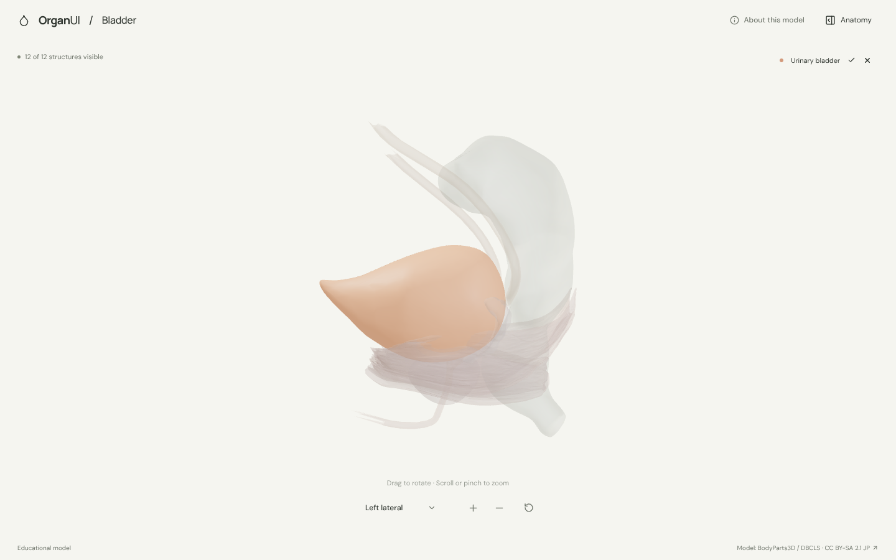
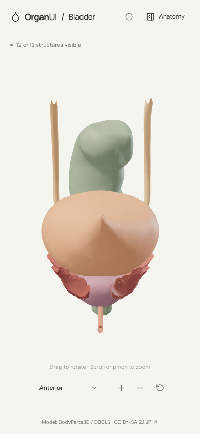

# OrganUI Bladder

A minimal, standalone, open-source explorer of the urinary bladder and its pelvic neighbours, built with React, TypeScript, Three.js, React Three Fiber, Vite, and Bun. It follows the shared behaviour of the other OrganUI explorers, with [heart-3d](https://github.com/organui/heart-3d) as the reference.

**Status:** working local demo. Twelve selectable structures, a real bundled model, responsive layouts, and checked desktop/mobile interactions. Public deployment and clinical anatomy review have not been done.



## Run locally

Install [Bun](https://bun.sh/) **1.4.2 or newer**, then:

```sh
git clone https://github.com/organui/bladder-3d.git
cd bladder-3d
bun install --frozen-lockfile
bun run dev
```

Open **http://127.0.0.1:5173**. No environment variables, accounts, API keys, sibling repositories, or model downloads are needed after installing dependencies. The ready-to-use 1.8 MB GLB is in `public/models/`.

```sh
bun run typecheck       # TypeScript checks, including the model scripts
bun run test            # Unit tests for selection emphasis, picking, and the anatomy-tree adapter
bun run verify:model    # Check the GLB hash, source IDs, and valid geometry
bun run build           # Typecheck and create dist/
bun run preview         # Serve the production build at http://127.0.0.1:4173
bun run format:check    # Check formatting
```

The app is static and uses relative build paths, so `dist/` can be hosted on any static web server. No deployment has been performed.

## Explore

- The model opens in an anterior view: the bladder, the pelvic part of both ureters, the urethra, the prostate and seminal vesicles, four pelvic floor muscles, and the rectum behind them.
- Drag to rotate; scroll or pinch to zoom. The view menu has anterior, posterior, and left lateral presets, each fitted to the model by the shared `src/framing.ts`. Rotating changes the label to **Custom view**; zooming and selecting do not.
- The header **Anatomy** button opens the OrganUI registry `anatomy-tree`, grouped into urinary tract, reproductive organs, pelvic floor, and neighbouring organs. Each structure shows its mesh colour. Group rows expand and collapse and toggle visibility for their structures; they do not select.
- Selecting a structure in 3D or in the tree makes it glow in its own colour and ghosts everything else. A chip above the canvas names the selection; its name opens the panel. Escape or close returns focus to the **Anatomy** button.
- Isolate, hide, or restore structures. **Reset** restores the anterior view, zoom, visibility, selection, tree search, and tour.
- A five-stop guided exploration follows urine from the ureters through the bladder and urethra, then looks at the prostate and the pelvic floor.
- Keyboard: Tab/Enter for controls; focus the model and use the arrow keys to rotate and `+`/`-` to zoom. All anatomy text is available without WebGL, and reduced-motion preferences turn off camera damping.

<details>
<summary>Anatomy panel, 3D selection, and mobile screenshots</summary>







</details>

## Model, credits, and review status

> BodyParts3D, © The Database Center for Life Science licensed under CC Attribution-Share Alike 2.1 Japan.

The model is a curated subset of **BodyParts3D 3.0**, taken from a checksum-pinned public [GitHub mirror](https://github.com/Kevin-Mattheus-Moerman/BodyParts3D) of the official archive. The model data is licensed **[CC BY-SA 2.1 Japan](https://creativecommons.org/licenses/by-sa/2.1/jp/deed.en)**, separately from this repository's **MIT code license**. Read [model provenance](docs/MODEL_PROVENANCE.md) for why this source and license were chosen, plus [asset attribution](public/models/ATTRIBUTION.md) and the [checksum manifest](public/models/manifest.json). Fonts are bundled locally under the SIL Open Font License; see [third-party notices](public/licenses/README.md).

Known limitations:

- This is a single adult male reference model, so it shows male pelvic anatomy only. It is not complete or patient-specific, and the bladder is shown at one fill level.
- The ureters are cut above the bladder at the top of the rectum, and the urethra is cut where it leaves the pelvis. The kidneys, bladder wall layers, trigone, sphincters, vas deferens, other pelvic floor muscles, vessels, nerves, and bones are omitted.
- Descriptions summarise NIDDK references. **Expert anatomical review is pending.** This is an educational interface demonstration, not a diagnostic, treatment, or measurement tool.
- Browser checks used headless Chromium with software WebGL at desktop and phone sizes, not physical devices or a screen reader.

## Reproduce the model

```sh
bun run prepare:model
bun run verify:model
```

This downloads the twelve pinned STL files (about 6 MB) into ignored `.asset-cache/` only when they are missing, verifies their SHA-256 hashes, and writes the GLB and manifest. Conversion selects real meshes, trims the ureters and urethra, transforms coordinates, recomputes normals, and applies colours. It does not invent or simplify geometry.

## Code

- `src/anatomy.ts`: source-ID mappings, explanatory text, and guided stops.
- `src/App.tsx`: selection/visibility state and accessible interface controls.
- `src/components/ui/anatomy-tree.tsx`: OrganUI registry component installed with the shadcn CLI; tracked unmodified. See [registry integration](docs/REGISTRY_INTEGRATION.md).
- `src/anatomy-adapter.ts`: tree data, group/leaf mapping, and visibility conversion for this scene.
- `src/Viewer.tsx`, `src/framing.ts`: loading, emphasis, picking, and camera framing shared with the other explorers.
- `scripts/`: pinned source inputs, reproducible conversion, and runtime validation.

See [verification](docs/VERIFICATION.md).

## License

Original application code: [MIT](LICENSE). The anatomy model, derived model images, fonts, and icons keep their separately documented licenses.

Part of [OrganUI](https://github.com/organui).
